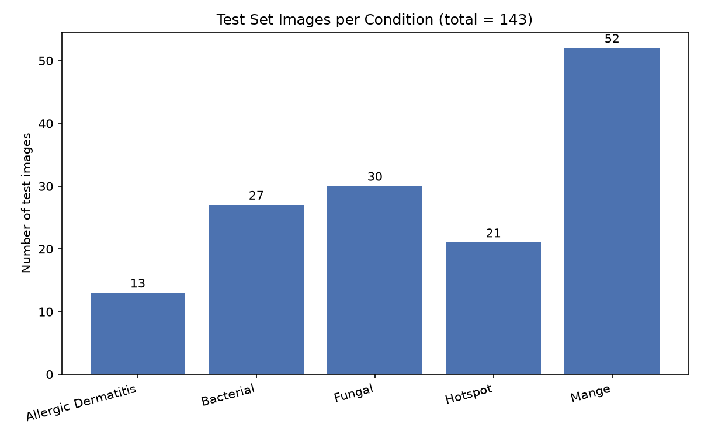
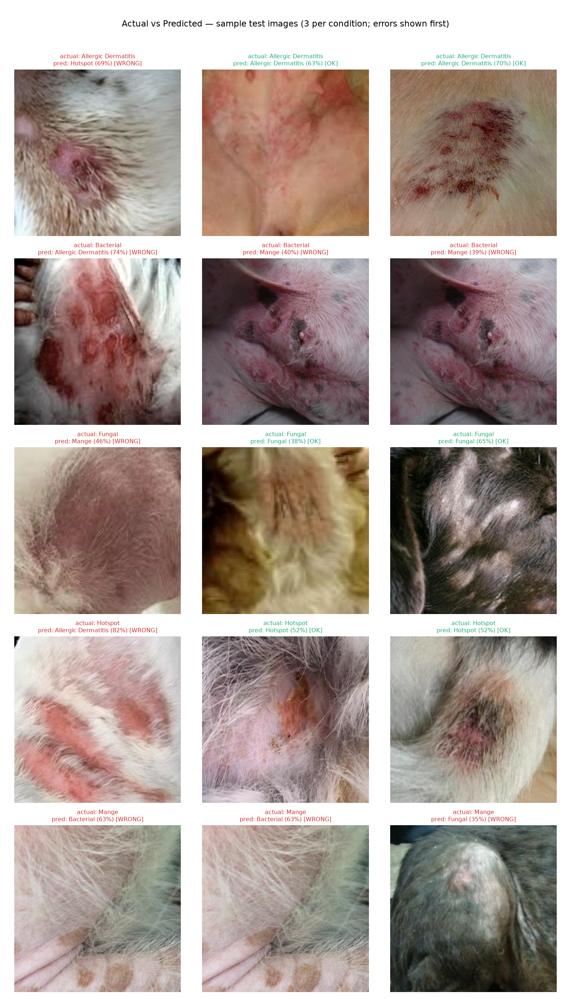
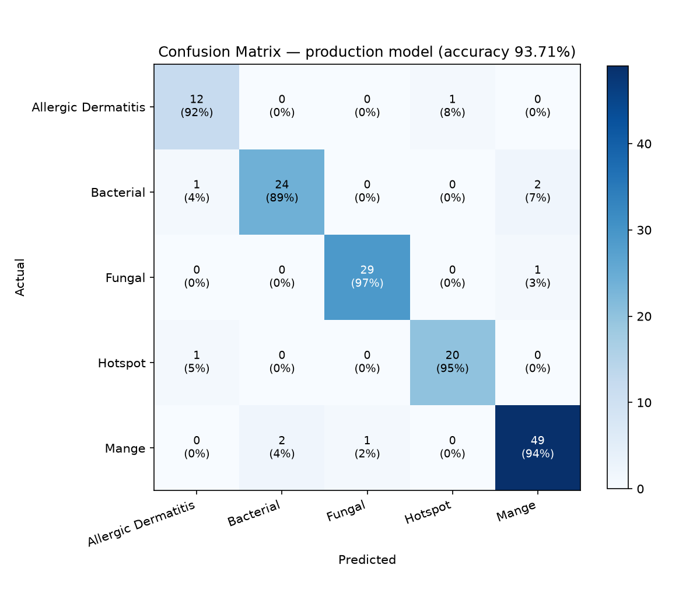

# Test-Set Evaluation — Production Model

- **Model:** `models/fine_tuned_best_effnet_clean_5class_s42.keras`
- **SHA-256:** `2f224d555a960be9b18cb5f9a3cc7eb4e5740cdef14d013f4f9effb375653e4f`
- **Dataset:** `ProcessedDataset224_Clean_5class/Test` (5 conditions, 143 images)
- **Generated:** 2026-11-15 09:54
- **Overall accuracy:** **93.71%** (134/143 correct)

---

## 1. Test dataset

Number of images used for each of the five conditions:

| Condition | Images | Share |
| --- | --- | --- |
| Allergic Dermatitis | 13 | 9.1% |
| Bacterial | 27 | 18.9% |
| Fungal | 30 | 21.0% |
| Hotspot | 21 | 14.7% |
| Mange | 52 | 36.4% |
| **Total** | **143** | **100%** |

---

## 2. Actual vs. predicted results

Sample images alongside their reference diagnoses and model predictions.
Each caption shows the reference (actual) diagnosis, the model's prediction,
its confidence, and whether the prediction was correct. Misclassified samples
are shown first. (3 samples per condition.)

---

## 3. Confusion matrix

How often each condition is correctly or incorrectly classified.
Cells show image counts and row percentages (row = actual condition).

| Actual \ Predicted | Allergic Dermatitis | Bacterial | Fungal | Hotspot | Mange |
| --- | --- | --- | --- | --- | --- |
| **Allergic Dermatitis** | 12 | 0 | 0 | 1 | 0 |
| **Bacterial** | 1 | 24 | 0 | 0 | 2 |
| **Fungal** | 0 | 0 | 29 | 0 | 1 |
| **Hotspot** | 1 | 0 | 0 | 20 | 0 |
| **Mange** | 0 | 2 | 1 | 0 | 49 |

---

## 4. Classification metrics

Accuracy, precision, recall, and F1-score per condition and overall.

| Class | Precision | Recall | F1-score | Support |
| --- | --- | --- | --- | --- |
| Allergic Dermatitis | 0.857 | 0.923 | 0.889 | 13 |
| Bacterial | 0.923 | 0.889 | 0.906 | 27 |
| Fungal | 0.967 | 0.967 | 0.967 | 30 |
| Hotspot | 0.952 | 0.952 | 0.952 | 21 |
| Mange | 0.942 | 0.942 | 0.942 | 52 |
| **Accuracy** |  |  | **0.9371** | 143 |
| Macro avg | 0.928 | 0.935 | 0.931 | 143 |
| Weighted avg | 0.938 | 0.937 | 0.937 | 143 |

Full sklearn report: [`classification_report.txt`](classification_report.txt) · raw values: [`metrics.csv`](metrics.csv)
